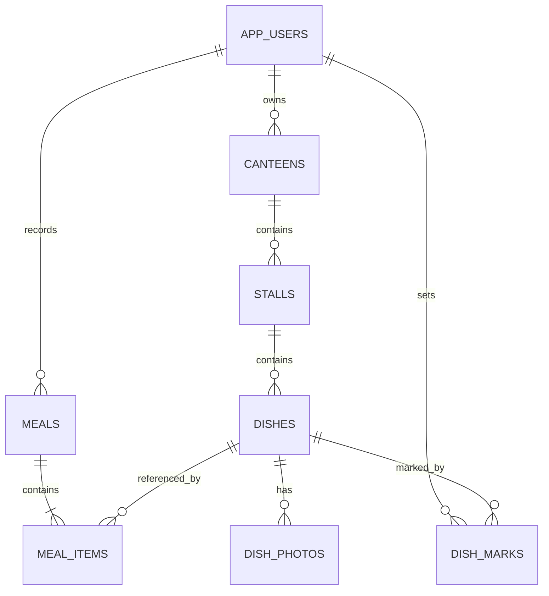

# 第一阶段设计说明

## 设计目标

提供能实际调用的 Java 后端，覆盖用户自建菜单、用餐记录、决策和统计。界面不在本阶段范围内，接口应能直接为后续的首页、食记、我的三个页面提供数据。

## 分层与职责

- Controller：HTTP 路径、请求类型、输入校验及状态码，不直接访问数据库。
- Service：业务约束、所有权检查和事务边界。CatalogService 管理菜单与筛选，MealService 保证整餐保存原子性，InsightsService 聚合评分和消费，PhotoService 管理真实文件与元数据。
- FoodRepository：统一 JDBC 访问、结果映射、菜单筛选和历史记录读取；部分业务聚合 SQL 随业务服务组织，后续可按模块拆分仓储。
- 不可变 record：表达请求和查询结果，减少共享可变对象。
- CurrentUser：隔离身份来源。单人版返回初始化用户，业务代码仍按用户隔离。

## 数据关系

meal_items 保存菜名快照、份数、该菜的总实付金额和可选评分。四项评分全有或全无；数据库同时设置金额、评分、标记互斥等约束。用户只按餐统计次数，不能把一次吃两个菜算成两餐。

菜品标签按经过校验的逗号分隔形式存储，不允许标签内带逗号，查询按整个标签匹配；课程小数据集采用此简单方案。标签数量最多 8 个，后续多标签复杂组合可拆为关联表。

## 关键流程

### 新增或替换一餐

1. 在事务中写入或更新餐头。
2. 验证每个菜品属于当前用户，检查重复菜品和可用状态。
3. 保存快照、实付金额和四项评分。
4. 任一明细失败，整餐及修改前的数据都通过事务回滚恢复。

### 推荐

数据库组合筛选 → 排除父级或菜品归档、踩雷 → 在所有候选中等概率抽样。没有候选时返回明确业务错误，不擅自放宽预算。第一阶段不使用机器学习或虚构的智能推荐。

### 榜单

按当前用户有效评分聚合，支持不同评分维度，实时查询而不复制一份容易过期的排行榜表。相同分数按评价数和 ID 稳定排序。新增、修改、删除评分会立即反映到榜单。

### 月度消费

先求每餐总金额，再按日期聚合，使用半开月份区间防止边界重复。补齐无消费日期，使用 BigDecimal 计算平均值，零餐月份返回零而不是除零。

### 照片

不信任扩展名或客户端 Content-Type；检查真实格式、像素数及解码结果。使用随机文件名，限制文件大小。上传后数据库事务回滚时清理新文件，删除时提交成功后清理文件；异常断电可能遗留孤立文件，生产版可增加定期对账。

## 当前边界及下一阶段

- 暂无身份认证、共享菜单、用户间操作；不是完整多人系统。
- 暂无重复提交幂等控制；前端应防止重复点击。
- 暂无数据库版本迁移工具；schema.sql 适用于 demo 初始建库。已有结构发生变更时应另行设计迁移，不直接清空用户数据库。
- 无跨域开放规则，后续前端通过同源代理对接或增加明确的来源配置。
- 数据量较小时先完成正确性；多人数据增长后再引入数据库分页、聚合优化和查询索引调整。

## 验证策略

真实 Spring Boot 上下文和独立内存数据库验证消费、评分平均、事务回滚、用户隔离、归档、日期边界和图片生命周期；通过实际随机端口 HTTP 请求验证输入校验、JSON 合同、错误状态和小规模并发查询。避免重复截图验证。
